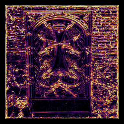

# SHREC 2026: Reconstruction of high-frequency geometry in synthetic heritage

- Novel synthetic Khachkar dataset for evaluating untextured 3D stone surfaces.
- FACD metric penalizes smoothing bias to evaluate fine 3D micro-topography.
- Evaluation of 8 reconstruction paradigms shows that global averages misrank methods.

<p align="center"></p>

## Abstract

**The geometric evaluation of 3D reconstruction techniques, spanning from classical structure-from-motion (SfM) to contemporary neural implicit representations and Gaussian splatting, remains a challenge. In cultural heritage applications, the preservation of high-frequency surface details, such as tool marks, inscriptions and reliefs, is often of greater significance than global shape approximation. Traditional metrics, notably the Chamfer Distance (CD), are frequently inadequate as their reliance on global error averaging masks the loss of critical micro-topography. To address this, in this Shape Retrieval Challenge (SHREC) track we introduce a novel benchmarking framework comprising: (1) a controlled, procedurally generated synthetic dataset of Khachkar-inspired stone reliefs, fully reproducible; and (2) the Feature-Aware Chamfer Distance (FACD), a feature-aware distance function designed to prioritize structurally and significantly geometric features. Three teams each submitted one run, and the organizers contributed five baseline reconstructions, for a total of eight configurations evaluated under a common protocol. Our evaluation reveals that standard CD frequently misranks models by favoring global smoothness over detail preservation. By providing more archaeologically plausible assessments, our FACD reveals a persistent fidelity gap, showing that current state-of-the-art methods still lack the nuance required for feature optimization.**

## The dataset

This repository documents the full SHREC 2026 dataset and is, at the same time,
the GRSI replication package for the paper. The two data distributions are
different and should not be confused:

| | Full dataset | Evaluation subset (GRSI) |
|---|---|---|
| Purpose | Development and benchmark of reconstruction methods | Reproduce Table 4 of the paper |
| Objects | 616 | 4 |
| Contents | 90 renderings at 1920×1080 and the camera poses (COLMAP and JSON) per object | Ground-truth meshes, the FACD weights used in the paper and the eight reconstructions |
| Size | ~33 GB total: ~20.3 GB renders/cameras (Kaggle) + ~12.7 GB ground-truth archives (Zenodo); the ground truth is ~61 GB unpacked | ~480 MB download, ~1 GB unpacked |
| Where | [Kaggle](https://www.kaggle.com/datasets/cristianllull/shrec-2026-retrieval-of-high-frequency-geometry) and [Zenodo](https://doi.org/10.5281/zenodo.23584779) (3D ground truth) | [Zenodo record 23584779](https://doi.org/10.5281/zenodo.23584779) |

### Full dataset (616 objects)

The 616 objects given to the participants (90 renderings at 1920×1080 per object
and the camera poses in COLMAP and JSON formats) are on Kaggle:
[SHREC 2026: Retrieval of High-Frequency Geometry](https://www.kaggle.com/datasets/cristianllull/shrec-2026-retrieval-of-high-frequency-geometry).

Objects are named `90_1920x1080_relief_heightmap_{ID}_{TYPE}_{SHAPE}_{DERIVATIVE}`,
where `ID` is the source Khachkar image, `TYPE` is `all` (every visible face
sculpted) or `one_face` (only the main face sculpted), `SHAPE` is empty (normal
cube), `large`, `wide` or `realistic`, and `DERIVATIVE` is empty (Primitive) or
one of `cone`, `cylinder`, `egg`, `package`, `pyramid`, `sphere`
(paper Sec. 3.1).

The full synthetic ground-truth meshes (and their curvature weights) are
distributed as Zenodo archives, one per category
(`All_faces_primitives`, `All_faces_derivatives`, `One_face_primitives`,
`One_face_derivatives`), and can be downloaded with
`bash download/download_full_dataset.sh <ZENODO_RECORD_ID_OR_DOI>` (see
`download/README.md`). The scripts used to generate the dataset and to run the
baselines (COLMAP, NeuS, VGGT) are in
[CILT/3d-evaluation](https://github.com/CILT/3d-evaluation).

### Evaluation subset (GRSI replication, ~480 MB)

The minimal data needed to reproduce Table 4 is downloaded by
`download/download_evaluation_subset.sh`. It contains four objects, each with
the ground-truth mesh `gt.obj`, the weights used in the paper
`gt_curvature_paper.json` and the eight reconstructions defined in
`FACD_Evaluation/compute_facd.py` (mirrored in `configs/experiment.yaml`):

| Object | Paper description |
|---|---|
| `90_1920x1080_relief_heightmap_5_one_face_wide` | Example 1: high-frequency relief |
| `90_1920x1080_relief_heightmap_6_one_face_large` | Example 2: high-frequency relief |
| `90_1920x1080_relief_heightmap_3_one_face_large_pyramid` | Example 3: complex topology and untextured stone |
| `90_1920x1080_relief_heightmap_1_all_wide_package` | Example 4: straight and curved edges |

The archive is verified against `download/SHA256SUMS.txt`, which uses the same
`sha256sum` manifest format as the full-dataset downloader. The format of the
evaluation subset itself is described in
`data/SHREC2026_FACD_Table4/README.txt` once downloaded.

## GRSI replication package

### What is reproduced

Table 4 of the paper: CD, HCD, HCD2, FACD, HFACD and HFACD2 of the eight
reconstructions of four objects. The four VGGT reconstructions (`vggt_frame`,
`vggt`, `vggt_100k`, `vggt_high_def`) were registered to the ground-truth frame
with `alignment/align_umeyama_iterations.py` (paper Sec. 3.3); the evaluation
archive contains the aligned results, so re-running the alignment is not needed
to reproduce the table.

### Requirements

Linux x86_64 (Ubuntu 22.04 or newer; developed on Debian 12). Only `bash`,
`tar`, `sha256sum`, `awk` and one of `wget`, `curl` or `python3` are needed from
the system. Python and all libraries are installed privately by the installation
script; no root access is needed.

### Installation

From the repository root:

```bash
bash installation/install_dependencies.sh          # CPU only, ~2 min
bash installation/install_dependencies.sh --cuda   # optional: also builds the CUDA kernel used for the paper
```

`install_dependencies.sh` downloads a private [Miniforge](https://github.com/conda-forge/miniforge)
into `./.miniforge`, creates the Python 3.10 environment described by
`installation/environment.yml` in `./.env` and installs PyTorch (2.7.1 CPU, or
2.6.0 for the CUDA 11.8 build). Nothing is installed outside the repository;
delete `.miniforge/` and `.env/` to uninstall.

Nearest neighbours are found either with the CUDA brute-force kernel of
[chamferdist](https://github.com/krrish94/chamferdist)/[PyTorch3D](https://github.com/facebookresearch/pytorch3d)
(`FACD_Evaluation/localchamferdist`, built by `install_dependencies.sh --cuda`,
which installs the CUDA 11.8 toolkit and GCC 11 into the environment; it needs
an NVIDIA driver supporting CUDA 11.8) or, when it is not built or no GPU is
available, with an exact KD-tree search (`scipy.spatial.cKDTree`). The KD-tree is
selected automatically and is fast enough on a CPU.

### Reproducing Table 4

```bash
bash scripts/reproduce_table_04.sh
```

The script takes no parameters (and runs the installation and download steps
first if needed). It

1. downloads and verifies the evaluation subset into `data/`
   (`download/download_evaluation_subset.sh`);
2. computes the FACD weights of the four ground-truth meshes (`gt_curvature.json`)
   and compares them with the weights used in the paper (`gt_curvature_paper.json`);
3. computes CD, HCD, HCD2, FACD, HFACD and HFACD2 of the eight reconstructions of
   each object;
4. writes Table 4 to `results/table4.md` and `results/table4.tex` and compares
   every value with the paper (`reference/table4_paper.csv`).

The weights and evaluation parameters are read from
`configs/experiment.yaml`; the defaults are the values used for the paper (weight
range `[1, 300]`, 90th percentile clamp, `gamma = 2`).

It takes ~7 min on an 8-core CPU with < 1 GB of RAM, and ends with:

```
Compared 128 values with the paper:
  123 identical to the printed 6 decimals, 5 within 0.1% (largest relative difference among them 7.14e-04), 0 differ, 0 missing.
  Best / second best / worst method identical in 16 of 16 rows.
RESULT: PASS - Table 4 of the paper is reproduced.
```

The five values that are not identical to the printed decimals differ by at most
0.07 %, and the best, second-best and worst methods of every row are the same as
in the paper. They come from two known sources:

- For `6_one_face_large`, 43 of the 453,608 recomputed weights (a small patch at
  one bottom corner) differ from the weights used in the paper, which were
  computed on another machine. The other three objects give bit-identical
  weights. This changes FACD and HFACD2 of `sam_sugar` on that object by < 0.07 %.
- The paper used the float32 CUDA kernel; the KD-tree computes distances in
  float64, which changes a few values by ~1e-6.

With the paper's weights and the CUDA kernel, all 128 values are identical to the
paper:

```bash
bash installation/install_dependencies.sh --cuda
(cd FACD_Evaluation && ../.env/bin/python compute_facd.py --root_dir ../data/SHREC2026_FACD_Table4 \
    --weights_name gt_curvature_paper.json --output_csv ../results/table4_distances.csv)
.env/bin/python FACD_Evaluation/make_table4.py
```

Output files in `results/`:

| File | Content |
|---|---|
| `table4.md`, `table4.tex` | Table 4 (best in bold, second best in italics/underlined, worst with `*`). |
| `table4_distances.csv` | One row per (`experiment_id`, `method`): `cd`, `hcd`, `hcd_2`, `facd`, `hfacd`, `hfacd_2`, `num_source_pts` (reconstruction), `num_target_pts` (ground truth). |
| `table4_compare.csv` | For every cell of Table 4: computed value, value in the paper, absolute and relative difference. |

The weight files are JSON objects `{"<0-based vertex index in gt.obj>": weight}`.
See `results/README.md` for the PASS/FAIL criteria.

### Reproducing Figure 1 (the README image)

```bash
bash scripts/reproduce_figure_01.sh
```

This renders the FACD weight map of relief 1, one_face — the image at the top of
this README (`docs/teaser_250x250.png`) — to `results/figure_01.png`, at
250×250 px, and compares it pixel by pixel with the committed image. The mesh
and weights are included in `sample/figure_01.tar.gz` (~13 MB), so the figure
does not need the full dataset. The script also accepts the object from the full
dataset via `SHREC_FULL_DATASET=/path/to/3D_ground_truth_dataset`.

### Camera alignment for the VGGT reconstructions

The four VGGT reconstructions evaluated in Table 4 were aligned to the
ground-truth frame with `alignment/align_umeyama_iterations.py` (paper
Sec. 3.3; `keep_ratio=0.8`). The evaluation archive already contains those
aligned models, so running the script is **not required to reproduce Table 4**;
it is required to regenerate the aligned VGGT models from the raw VGGT outputs.
See `alignment/README.md` for the optional Open3D environment, the
method-to-file mapping and usage.

## FACD: Feature-Aware Chamfer Distance

FACD weights every ground-truth vertex by its curvedness, so that losing carvings,
tool marks and edges is penalised instead of being averaged away (paper Sec. 3.2):

1. **Weights** (`WeightComputation/compute_weights.py`): the ground-truth mesh is
   cleaned (welding, degenerate and duplicate faces, orphan vertices), principal
   curvatures `k1, k2` are computed with libigl, the curvedness
   `C = sqrt((k1² + k2²)/2)` is clamped at the 90th percentile of the active
   curvatures (`C > 1e-5`), normalised to [0, 1] and mapped to
   `W = 1 + 299 · Ĉ²`, i.e. weights in [1, 300].
2. **Distances** (`FACD_Evaluation/compute_facd.py`): the forward
   (reconstruction → GT) and backward (GT → reconstruction) squared
   nearest-neighbour distances are weighted by the GT weights (the forward term
   uses the weight of the nearest GT vertex) and averaged, giving FACD, and their
   harmonic means, HFACD and HFACD2. The unweighted CD, HCD and HCD2 are computed
   alongside.

`WeightComputation/render_weights.py` renders the weight map of the front face of
a Primitive; it produces the README teaser (Figure 1) and the weight-map
illustration of the paper.

### Evaluate a single reconstruction

`scripts/evaluate_reconstruction.py` computes the six metrics for one
(reconstruction, ground truth) pair, using the same code and parameters as
Table 4. The weights are taken from `gt_curvature.json` if it is next to the
ground truth, and computed otherwise.

```bash
.env/bin/python scripts/evaluate_reconstruction.py \
    --ground_truth   data/SHREC2026_FACD_Table4/<object>/gt.obj \
    --reconstruction data/SHREC2026_FACD_Table4/<object>/<reconstruction> \
    --output_csv     results/evaluation.csv
```

Reconstructions must already be registered to the ground-truth frame
(paper Sec. 3.3). See `sample/README.md` for a complete example with expected
values.

### Use FACD in your code

The distances can also be used directly from Python, with `FACD_Evaluation/` on
the path (e.g. `cd FACD_Evaluation && PYTHONPATH=. ../.env/bin/python my_script.py`):

```python
import torch
from localchamferdist import ChamferDistance
from localchamferdist.fachamfer import FeatureAwareChamferDistance

gt = torch.rand(1, 1000, 3)              # ground truth, (batch, points, 3)
rec = torch.rand(1, 800, 3)              # reconstruction
w = 1 + 299 * torch.rand(1, 1000)        # one weight per ground-truth point

facd = FeatureAwareChamferDistance()
fwd = facd(gt, rec, weights_source=w, reverse=True, point_reduction="mean")   # reconstruction -> GT
bwd = facd(gt, rec, weights_source=w, reverse=False, point_reduction="mean")  # GT -> reconstruction
print(0.5 * (fwd + bwd))                 # FACD
```

## Repository structure

| Path | Content |
|---|---|
| `README.md` | This file: project, full dataset and GRSI replication package. |
| `submission_info.txt` | Title, authors, operating system, hardware and commands for the GRSI submission. |
| `LIABILITY_FORM.md` | GRSI liability and distribution declaration. |
| `LICENSE` | MIT license of the code. |
| `installation/install_dependencies.sh`, `installation/environment.yml` | Private Miniforge + Python environment (see above). |
| `download/download_evaluation_subset.sh` | Download and verify the ~480 MB evaluation subset into `data/`. |
| `download/download_full_dataset.sh` | Download the full synthetic ground-truth archives from Zenodo. |
| `download/SHA256SUMS.txt` | SHA-256 manifest of the evaluation subset. |
| `scripts/reproduce_table_04.sh` | Reproduction of Table 4. |
| `scripts/reproduce_figure_01.sh` | Reproduction of the README teaser (Figure 1). |
| `scripts/evaluate_reconstruction.py` | Evaluate one reconstruction with CD, HCD, HCD2, FACD, HFACD and HFACD2. |
| `alignment/` | Sim(3) camera alignment used for the VGGT reconstructions in Table 4 (paper Sec. 3.3), plus the COLMAP reader and a README. |
| `configs/experiment.yaml` | Data locations, weight parameters, methods and output directory. |
| `sample/README.md`, `sample/figure_01.tar.gz` | Figure 1 sample data and single-reconstruction example with expected values. |
| `results/README.md` | Output files and PASS/FAIL criteria. |
| `WeightComputation/` | `compute_weights.py` (FACD weights), `compare_weights.py`, `render_weights.py`. |
| `FACD_Evaluation/` | `compute_facd.py` (distances), `make_table4.py`, `localchamferdist/` (CD and FACD modules, C++/CUDA KNN), `setup.py`. |
| `reference/table4_paper.csv` | Values of Table 4 as printed in the paper. |
| `docs/teaser_250x250.png` | Teaser image (FACD weights of a Khachkar relief). |

## License

MIT, see [LICENSE](LICENSE). `FACD_Evaluation/localchamferdist` is derived from
[chamferdist](https://github.com/krrish94/chamferdist) (MIT, see
`FACD_Evaluation/localchamferdist/LICENSE_chamferdist`), whose KNN kernels come
from [PyTorch3D](https://github.com/facebookresearch/pytorch3d) (BSD).
Dependencies (PyTorch, NumPy, SciPy, libigl, meshio, psutil, matplotlib) are
under permissive (BSD, MIT, PSF-style) or MPL-2.0 licenses. The ground-truth
meshes and curvature annotations in the Zenodo record are licensed under
CC BY 4.0; the reconstructions in `SHREC2026_FACD_Table4.tar.gz` are attributed
to the participating teams in that archive's README. The renders and camera
parameters on Kaggle are released under Apache 2.0 (see [that page](https://www.kaggle.com/datasets/cristianllull/shrec-2026-retrieval-of-high-frequency-geometry)). The sample in
`sample/figure_01.tar.gz` is a small excerpt of the synthetic dataset,
distributed under CC BY 4.0. `alignment/align_umeyama_iterations.py` is covered
by the repository MIT License; `alignment/colmap_read_write_model.py` is derived
from COLMAP (ETH Zurich and UNC Chapel Hill, BSD 3-Clause) and retains its
license header.

## Citation

If you find FACD -- Feature-Aware Chamfer Distance useful, please cite:

```
@article{llull2026FACD,
    title = {SHREC 2026: Reconstruction of high-frequency geometry in synthetic heritage},
    journal = {Computers & Graphics},
    volume = {139},
    pages = {104726},
    year = {2026},
    issn = {0097-8493},
    doi = {https://doi.org/10.1016/j.cag.2026.104726},
    url = {https://www.sciencedirect.com/science/article/pii/S0097849326001974},
    author = {Cristián Llull and Ivan Sipiran and Francisca Gil and Nelson Baloian and Anthony Belessis and Vlassis Fotis and George Ioannakis and Efthymios Koukoulis and Konstantinos Moustakas and Sotiris Papatheodorou and Ioannis Pratikakis and Ioannis Romanelis and Kriti Singh and Eleftheria Solomonidi and Christoforos Vlachos and Vaia Zachari},
    keywords = {3D shape retrieval, 3D reconstruction, Cultural heritage},
}


```

If you find `chamferdist` work useful, you might want to cite the *original* implementation from which this codebase was borrowed (stolen!) - PyTorch3D.

```
@article{ravi2020pytorch3d,
    author = {Nikhila Ravi and Jeremy Reizenstein and David Novotny and Taylor Gordon
                  and Wan-Yen Lo and Justin Johnson and Georgia Gkioxari},
    title = {Accelerating 3D Deep Learning with PyTorch3D},
    journal = {arXiv:2007.08501},
    year = {2020},
}
```
