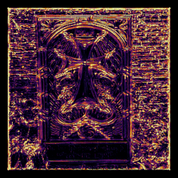

# SHREC 2026: Reconstruction of high-frequency geometry in synthetic heritage

- Novel synthetic Khachkar dataset for evaluating untextured 3D stone surfaces.
- FACD metric penalizes smoothing bias to evaluate fine 3D micro-topography.
- Evaluation of 8 reconstruction paradigms shows that global averages misrank methods.

<p align="center"></p>

## Abstract
**The geometric evaluation of 3D reconstruction techniques, spanning from classical structure-from-motion (SfM) to contemporary neural implicit representations and Gaussian splatting, remains a challenge. In cultural heritage applications, the preservation of high-frequency surface details, such as tool marks, inscriptions and reliefs, is often of greater significance than global shape approximation. Traditional metrics, notably the Chamfer Distance (CD), are frequently inadequate as their reliance on global error averaging masks the loss of critical micro-topography. To address this, in this Shape Retrieval Challenge (SHREC) track we introduce a novel benchmarking framework comprising: (1) a controlled, procedurally generated synthetic dataset of Khachkar-inspired stone reliefs, fully reproducible; and (2) the Feature-Aware Chamfer Distance (FACD), a feature-aware distance function designed to prioritize structurally and significantly geometric features. Three teams each submitted one run, and the organizers contributed five baseline reconstructions, for a total of eight configurations evaluated under a common protocol. Our evaluation reveals that standard CD frequently misranks models by favoring global smoothness over detail preservation. By providing more archaeologically plausible assessments, our FACD reveals a persistent fidelity gap, showing that current state-of-the-art methods still lack the nuance required for feature optimization.**


## Dataset

The 616 objects given to the participants (90 renderings at 1920×1080 per object and the camera
poses in COLMAP and JSON formats) are on Kaggle:
[SHREC 2026: Retrieval of High-Frequency Geometry](https://www.kaggle.com/datasets/cristianllull/shrec-2026-retrieval-of-high-frequency-geometry).

Objects are named `90_1920x1080_relief_heightmap_{ID}_{TYPE}_{SHAPE}_{DERIVATIVE}`, where `ID` is the source
Khachkar image, `TYPE` is `all` (every visible face sculpted) or `one_face` (only the main face
sculpted), `SHAPE` is empty (normal cube), `large`, `wide` or `realistic`, and `DERIVATIVE` is empty
(Primitive) or one of `cone`, `cylinder`, `egg`, `package`, `pyramid`, `sphere` (paper Sec. 3.1).

The evaluation subset needed to reproduce Table 4 (ground-truth meshes, FACD weights and the
eight reconstructions of four objects, ~480 MB) is downloaded by `download_data.sh`. Its format is
described in `data/SHREC2026_FACD_Table4/README.txt` once downloaded.


## FACD: Feature-Aware Chamfer Distance

FACD weights every ground-truth vertex by its curvedness, so that losing carvings, tool marks
and edges is penalised instead of being averaged away (paper Sec. 3.2):

1. **Weights** (`WeightComputation/compute_weights.py`): the ground-truth mesh is cleaned
   (welding, degenerate and duplicate faces, orphan vertices), principal curvatures `k1, k2` are
   computed with libigl, the curvedness `C = sqrt((k1² + k2²)/2)` is clamped at the 90th percentile
   of the active curvatures (`C > 1e-5`), normalised to [0, 1] and mapped to
   `W = 1 + 299 · Ĉ²`, i.e. weights in [1, 300].
2. **Distances** (`FACD_Evaluation/compute_facd.py`): the forward (reconstruction → GT) and backward
   (GT → reconstruction) squared nearest-neighbour distances are weighted by the GT weights (the
   forward term uses the weight of the nearest GT vertex) and averaged, giving FACD, and their
   harmonic means, HFACD and HFACD2. The unweighted CD, HCD and HCD2 are computed alongside.

### Installation

Linux x86_64 (Ubuntu 22.04 or newer; developed on Debian 12). Only `bash`, `tar`, `sha256sum` and
`wget` or `curl` are needed from the system. From the repository root:

```bash
bash install.sh          # CPU only, ~2 min
bash install.sh --cuda   # optional: also builds the CUDA kernel used for the paper
```

`install.sh` downloads a private [Miniforge](https://github.com/conda-forge/miniforge) into
`./.miniforge`, creates a Python 3.10 environment in `./.env` with the pinned packages of
`requirements.txt` and PyTorch 2.7.1, and checks the installation. No root access is needed and
nothing is installed outside the repository; delete `.miniforge/` and `.env/` to uninstall.

Nearest neighbours are found either with the CUDA brute-force kernel of
[chamferdist](https://github.com/krrish94/chamferdist)/[PyTorch3D](https://github.com/facebookresearch/pytorch3d)
(`FACD_Evaluation/localchamferdist`, built by `install.sh --cuda`, which installs the CUDA 11.8
toolkit and GCC 11 into the environment; it needs an NVIDIA driver supporting CUDA 11.8) or, when
it is not built or no GPU is available, with an exact KD-tree search (`scipy.spatial.cKDTree`).
The KD-tree is selected automatically and is fast enough on a CPU.

### Reproducing Table 4

```bash
bash reproduce_table4.sh
```

The script takes no parameters (and runs `install.sh` first if needed). It

1. downloads and checks the evaluation subset into `data/` (`download_data.sh`);
2. computes the FACD weights of the four ground-truth meshes (`gt_curvature.json`) and compares them
   with the weights used in the paper (`gt_curvature_paper.json`);
3. computes CD, HCD, HCD2, FACD, HFACD and HFACD2 of the eight reconstructions of each object;
4. writes Table 4 to `results/table4.md` and `results/table4.tex` and compares every value with the
   paper (`reference/table4_paper.csv`).

It takes ~7 min on an 8-core CPU with < 1 GB of RAM, and ends with:

```
Compared 128 values with the paper:
  123 identical to the printed 6 decimals, 5 within 0.1% (largest relative difference among them 7.14e-04), 0 differ, 0 missing.
  Best / second best / worst method identical in 16 of 16 rows.
RESULT: PASS - Table 4 of the paper is reproduced.
```

The five values that are not identical to the printed decimals differ by at most 0.07 %, and the
best, second-best and worst methods of every row are the same as in the paper. They come from two
known sources:

- For `6_one_face_large`, 43 of the 453,608 recomputed weights (a small patch at one bottom corner)
  differ from the weights used in the paper, which were computed on another machine. The other three
  objects give bit-identical weights. This changes FACD and HFACD2 of `sam_sugar` on that object
  by < 0.07 %.
- The paper used the float32 CUDA kernel; the KD-tree computes distances in float64, which changes
  a few values by ~1e-6.

With the paper's weights and the CUDA kernel, all 128 values are identical to the paper:

```bash
bash install.sh --cuda
(cd FACD_Evaluation && ../.env/bin/python compute_facd.py --root_dir ../data/SHREC2026_FACD_Table4 \
    --weights_name gt_curvature_paper.json --output_csv ../results/table4_distances.csv)
.env/bin/python FACD_Evaluation/make_table4.py
```

Output files in `results/`:

| File | Content |
|---|---|
| `table4.md`, `table4.tex` | Table 4 (best in bold, second best in italics/underlined, worst with `*`). |
| `table4_distances.csv` | One row per (`experiment_id`, `method`): `cd`, `hcd`, `hcd_2`, `facd`, `hfacd`, `hfacd_2`, `num_source_pts` (reconstruction), `num_target_pts` (ground truth). |
| `table4_compare.csv` | For every cell of Table 4: computed value, value in the paper, absolute and relative difference. |

The weight files are JSON objects `{"<0-based vertex index in gt.obj>": weight}`.

### Compute FACD on your own data

Put each object in its own folder with the ground truth as `gt.obj` and the reconstructions named
as in `SOURCES` at the top of `FACD_Evaluation/compute_facd.py` (edit that dictionary for other
methods). Reconstructions must already be registered to the ground-truth frame (paper Sec. 3.3).

```bash
.env/bin/python WeightComputation/compute_weights.py --root_dir /path/to/objects
cd FACD_Evaluation && ../.env/bin/python compute_facd.py --root_dir /path/to/objects --output_csv results.csv
```

The distances can also be used directly from Python, with `FACD_Evaluation/` on the path
(e.g. `cd FACD_Evaluation && PYTHONPATH=. ../.env/bin/python my_script.py`):

```python
import torch
from localchamferdist import ChamferDistance
from localchamferdist.fachamfer import FeatureAwareChamferDistance

gt = torch.rand(1, 1000, 3)              # ground truth, (batch, points, 3)
rec = torch.rand(1, 800, 3)              # reconstruction
w = 1 + 299 * torch.rand(1, 1000)        # one weight per ground-truth point

facd = FeatureAwareChamferDistance()
fwd = facd(gt, rec, weights_source=w, reverse=True, point_reduction="mean")   # reconstruction -> GT
bwd = facd(gt, rec, weights_source=w, reverse=False, point_reduction="mean")  # GT -> reconstruction
print(0.5 * (fwd + bwd))                 # FACD
```

`WeightComputation/render_weights.py` renders the weight map of the front face of a Primitive, as in
paper Fig. 9 (used for the image above).

## Repository structure

| Path | Content |
|---|---|
| `install.sh`, `requirements.txt` | Installation (see above). |
| `download_data.sh` | Download of the evaluation subset into `data/`. |
| `reproduce_table4.sh` | Reproduction of Table 4. |
| `README_GRSI.txt` | Title, authors and operating system for the Graphics Replicability Stamp. |
| `WeightComputation/` | `compute_weights.py` (FACD weights), `compare_weights.py`, `render_weights.py`. |
| `FACD_Evaluation/` | `compute_facd.py` (distances), `make_table4.py`, `localchamferdist/` (CD and FACD modules, C++/CUDA KNN), `setup.py`. |
| `reference/table4_paper.csv` | Values of Table 4 as printed in the paper. |

The scripts used to generate the dataset and to run the baselines (COLMAP, NeuS, VGGT) are in
[CILT/3d-evaluation](https://github.com/CILT/3d-evaluation).

## License

MIT, see [LICENSE](LICENSE). `FACD_Evaluation/localchamferdist` is derived from
[chamferdist](https://github.com/krrish94/chamferdist) (MIT, see
`FACD_Evaluation/localchamferdist/LICENSE_chamferdist`), whose KNN kernels come from
[PyTorch3D](https://github.com/facebookresearch/pytorch3d) (BSD). Dependencies (PyTorch, NumPy,
SciPy, libigl, meshio, psutil, matplotlib) are under permissive (BSD, MIT, PSF-style) or MPL-2.0
licenses.


# Citation

If you find FACD -- Feature-Aware Chamfer Distance useful, please cite:
```
@article{llull2026FACD,
    title = {SHREC 2026: Reconstruction of high-frequency geometry in synthetic heritage},
    journal = {Computers & Graphics},
    volume = {139},
    pages = {104726},
    year = {2026},
    issn = {0097-8493},
    doi = {https://doi.org/10.1016/j.cag.2026.104726},
    url = {https://www.sciencedirect.com/science/article/pii/S0097849326001974},
    author = {Cristián Llull and Ivan Sipiran and Francisca Gil and Nelson Baloian and Anthony Belessis and Vlassis Fotis and George Ioannakis and Efthymios Koukoulis and Konstantinos Moustakas and Sotiris Papatheodorou and Ioannis Pratikakis and Ioannis Romanelis and Kriti Singh and Eleftheria Solomonidi and Christoforos Vlachos and Vaia Zachari},
    keywords = {3D shape retrieval, 3D reconstruction, Cultural heritage},
}


```

If you find `chamferdist` work useful, you might want to cite the *original* implementation from which this codebase was borrowed (stolen!) - PyTorch3D.

```
@article{ravi2020pytorch3d,
    author = {Nikhila Ravi and Jeremy Reizenstein and David Novotny and Taylor Gordon
                  and Wan-Yen Lo and Justin Johnson and Georgia Gkioxari},
    title = {Accelerating 3D Deep Learning with PyTorch3D},
    journal = {arXiv:2007.08501},
    year = {2020},
}
```
